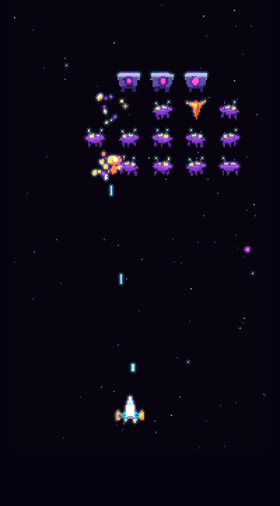

# Hivebreak

[](https://github.com/wayne-folkes/hivebreak/actions/workflows/ci.yml)

A pixel-art fixed shooter in your browser. Break the alien hive one wave at a time, and pick an
upgrade after each wave, so every run builds differently. Ships and aliens are real 3D models,
scripted in Blender and rendered at a low resolution for a crisp pixel look. TypeScript + Vite +
Three.js, no backend.



**Play it at [hivebreak.folkes.dev](https://hivebreak.folkes.dev)**, or run it yourself below.

## How it plays

A run is five waves. Drones make up most of the formation; Wardens are armoured, take two hits and
aim their shots at you; Divers break formation to swoop at you. Clear a wave and you pick one of
three upgrades (twin shot, rapid fire, piercing, extra life, shield pulse, thrusters), which stack
for the rest of the run. Each hit in a row raises your combo, up to x8; a shot that misses resets it.
Lose your last life, or let the formation reach your row, and the run ends. Your top 10 runs are kept
in the browser.

## Controls

Keyboard, gamepad and touch all work, and you can switch between them mid-run.

| Action | Keyboard | Gamepad (Xbox / PlayStation) | Touch |
|---|---|---|---|
| Move | ← → or A / D | Left stick or d-pad | Drag anywhere in the lower half; the ship moves by your thumb's offset |
| Fire (hold to auto-fire) | Space, Z or ↑ | A / Cross or RT | Automatic while a thumb is down |
| Pause | Esc or P | Start | ⏸ in the corner |
| Mute | M | | 🔊 in the HUD |
| Menus and upgrade picks | Arrows and Enter | D-pad or stick, A | Tap |

The controller rumbles when you're hit.

## Run it

```bash
cd client
npm install
npm run dev
```

`npm test` runs the unit tests (simulation, waves, upgrades, scoring, input, rendering maths, sound
recipes, the music sequencer, and whole runs played by a bot). `npm run build` type-checks and builds to `client/dist`.

`npm run models` rebuilds the ship and alien models from the Blender scripts (needs Blender on your
PATH). The exported `.glb` files are committed, so you only need Blender to change a model.

## Layout

- `client/src/game/`: game logic, free of rendering and the DOM, unit-tested with Vitest. `run.ts`
  is the entry point (`createRun`, `stepRun`, `pickUpgrade`); `types.ts` holds the shared shapes.
  Input (`controls.ts`, `input.ts`, `gamepad.ts`, `touch.ts`) and synthesized sound (`audio.ts`)
  live here too.
- `client/src/music/`: the soundtrack, synthesized live: a small sequencer on Web Audio
  (`music.ts`), the song format (`song.ts`, `pattern.ts`) and the songs as data (`tracks/`). In dev,
  `/music.html` auditions the tracks and stingers.
- `client/src/render/`: the Three.js renderer: models, effects, starfield, palette pass.
- `client/src/ui/`: menus, HUD and wave banner, as plain DOM.
- `client/src/main.ts` and `client/src/app/`: the game loop, screen flow and the music director
  (`director.ts`), which picks the track and its layers from the run.
- `art/blender/`: Blender Python scripts for the models; `art/previews/` has a render of each.
- `client/public/models/`: the exported `.glb` models.
- `client/design/`: sources for the favicon and the link-preview image; `render.sh` regenerates the
  PNGs in `client/public/` with headless Chrome.
- `docs/`: requirements and the slice plans.

## Licence

[MIT](LICENSE)
